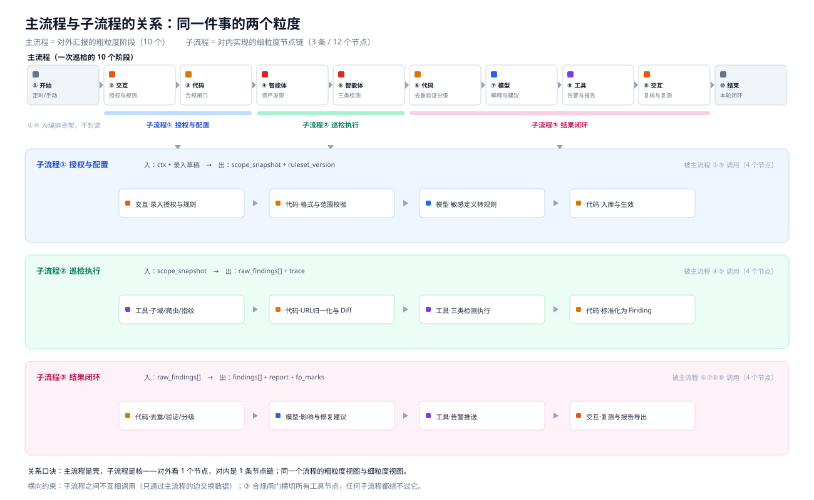

# 00 · 简化版框架（推荐主推）

> 详细版（`docs/02`、`04`、`05`、`06`）作为"设计深度"附录；**对外讲、动手做，都用这一版**。
> 架构图见 `docs/assets/simple_framework.svg`。

---

## 一、一句话

在授权范围内，**定时发现站点页面 → 编排开源工具做三类检测 → 去重验证分级后给出证据与整改建议 → 告警、复测、出报告**。

---

## 二、四个板块 + 一个基座

| 板块 | 干什么 | 对应赛题要求 |
| --- | --- | --- |
| **① 授权与调度** | 录入授权域名、巡检范围、周期、敏感信息定义；出站前做范围校验与限速 | 要求① |
| **② 发现与检测** | 发现页面与资源，按策略调用开源工具，做漏洞/弱配置、篡改/挂马、敏感信息三类检测 | 要求② |
| **③ 结果处理** | 跨工具去重、非破坏性验证、风险分级，给出证据、影响与修复建议 | 要求③ |
| **④ 闭环运营** | 基线对比、分级告警、复测、报告导出 | 要求④ |
| **基座·数据与工具** | 资产库、基线库、证据仓、敏感规则库、工具适配器池、审计日志 | 要求⑤⑥ |

---

## 三、主流程：10 个节点

```
① 开始 · 定时/手动
② 交互 · 授权与规则录入            ← 域名 / 范围 / 周期 / 敏感信息定义
③ 代码 · 合规闸门                  ← 范围校验 + 限速 + 时间窗（越界即拒）
④ 智能体 · 资产与页面发现          ← 子域 / 指纹 / 爬虫 / 资源清单
⑤ 智能体 · 三类检测                ← 漏洞弱配置 / 篡改挂马 / 敏感信息
⑥ 代码 · 去重 · 验证 · 分级        ← 统一 Finding 模型 + 跨工具合并 + 二次确证
⑦ 模型 · 证据解释与修复建议        ← 影响 + 分角色整改项（自动脱敏）
⑧ 工具 · 告警与报告导出            ← P0/P1 即时推送，其余日报；导出 MD/PDF
⑨ 交互 · 人工复核与复测            ← 确认处置、标记误报、重放检测项
⑩ 结束 · 本轮闭环                  ← 基线反哺下一轮
```

节点类型只用到 6 种：开始/结束、交互、代码、智能体、模型、工具。**自规划节点可选**——第一版不必上，用固定编排即可（见第六节）。

---

## 四、三条子流程

| 子流程 | 节点链 | 说明 |
| --- | --- | --- |
| ① 授权与配置 | 交互·录入 → 代码·格式校验 → 模型·敏感定义转规则 → 代码·入库生效 | 4 个节点，替代原 13 节点流程 |
| ② 巡检执行 | 工具·子域/爬虫/指纹 → 代码·URL 归一化与 Diff → 工具·三类检测 → 代码·标准化 Finding | 4 个节点 |
| ③ 结果闭环 | 代码·去重/验证/分级 → 模型·影响与建议 → 工具·告警推送 → 交互·复测与导出 | 4 个节点 |

---

## 五、简化前后对照

| 维度 | 详细版 | 简化版 |
| --- | --- | --- |
| 板块 | 7 个 | 4 个 + 1 基座 |
| 子流程 | 8 条 | 3 条 |
| 节点总数 | 71 个 | 22 个（减少约 70%） |
| 主流程 | 14 节点、含 fork/join 与 4 条旁路边 | 10 节点、单链 + 1 条闭环边 |
| 授权流程 | 13 节点（含权限审批、授权书 OCR 核对、版本回滚） | 4 节点 |
| 并行检测 | 三条分支 fork/join | 同一智能体节点内串行执行 |

---

## 六、砍掉了什么、为什么可以砍

| 砍掉的内容 | 为什么能砍 | 什么时候补回来 |
| --- | --- | --- |
| 自规划节点的动态规划 | 固定编排已能覆盖赛题；自规划反而容易越界，是合规风险点 | 有余力时用于"工具失败改道"，但要锁死授权边界 |
| 授权书 OCR 交叉核对 | 演示时用人工确认即可 | 拿授权书样例后补，是很好的加分点 |
| 并行 fork/join | 串行执行结果等价，只是慢 | 请求量大的资产再并行 |
| 权限角色矩阵、审批流 | 比赛环境单一角色 | 不必补 |
| 13 节点授权流程的版本回滚 | 保留"配置入库 + 版本号"即可 | 不必补 |
| 13 种边的类型划分 | 简化为主边 + 条件边 + 闭环边 3 种 | 不必补 |

---

## 七、砍不掉的四件事（缺一个就丢分）

1. **合规闸门**（③ 节点）——范围校验 + 限速 + 审计日志，对应"安全合规 10%"，也是法律底线。
2. **去重 + 验证**（⑥ 节点）——决定"检测效果 30%"里的误报率；报告里要能显示"原始命中 N → 去重后 M"。
3. **证据 + 影响 + 修复建议**（⑦ 节点）——"智能体能力 20%"的直接给分点。
4. **基线对比 + 复测**（⑧⑨ 节点）——没有它，就是"扫描器"而不是"巡检智能体"，功能完整性要丢一半分。

---

## 八、两周 MVP 建议

| 阶段 | 做什么 | 产出 |
| --- | --- | --- |
| 第 1 周 | ①②③④ 节点跑通：授权录入 → 页面发现 → 接入 2~3 个被动工具 | 能发现页面并跑出结果 |
| 第 2 周 | ⑤⑥⑦ 节点：三类检测各 1 个工具 + 去重验证分级 + 报告导出 | 端到端闭环可演示 |
| 第 3 周 | ⑧⑨ 节点：定时巡检 + 告警 + 复测 + 基线对比 | 闭环完整 |
| 第 4 周 | 打磨：统一测试集自评召回/误报、合规演练、恒脑平台适配、文档 | 提交材料 |

有余力再往上叠的是：自规划改道、授权书 OCR、视觉篡改比对、并行检测。

---

## 九、简化版与已有代码的对应（已可运行）

| 节点 | 对应代码 | 状态 |
| --- | --- | --- |
| ② 交互 · 授权与规则 | `framework/config/authorization.example.json` + `wn_agent/intake.py` | ✅ 已实现（格式校验 + 规则编译） |
| ③ 代码 · 合规闸门 | `wn_agent/gate.py` | ✅ 已实现（范围 / 限速 / 时间窗 / 档位 / 审计） |
| ④ 智能体 · 资产发现 | `wn_agent/agent.py`（discover）+ `wn_agent/fetcher.py` | ✅ 已实现（本地快照） |
| ⑤ 智能体 · 三类检测 | `wn_agent/tools.py` + `wn_agent/builtin_tools.py` | ✅ 已实现 5 个被动适配器 |
| ⑥ 代码 · 去重验证分级 | `wn_agent/agent.py`（Fuser / Verifier）+ `wn_agent/models.py` | ✅ 已实现 |
| ⑦ 模型 · 解释与建议 | `wn_agent/agent.py`（Explainer） | ✅ 已实现（模板版，可替换为模型节点） |
| ⑧ 工具 · 告警与报告 | `wn_agent/report.py` | ⚠️ 报告已实现，告警通道待接 |
| ⑨⑩ 交互 / 结束 | `wn_agent/cli.py` + `wn_agent/memory.py` | ✅ 已实现（基线 / 生命周期） |

`python -m wn_agent.cli --demo` 跑的就是这条简化主流程的两轮闭环。

---

## 十、主流程与子流程的关系



### 一句话

**主流程是壳，子流程是核。** 它们不是两条流程，而是同一个流程的两个粒度：

- **主流程（10 个阶段）**：对外汇报用——看清"巡检从哪来、到哪去、谁先谁后"；
- **子流程（3 条 / 12 个节点）**：对内开发用——看清"每个阶段内部怎么实现"；
- **接缝在智能体节点**：对外是 1 个节点，对内是 1 条节点链。

### 归属关系（谁包住谁）

| 主流程节点 | 归属 | 展开后的子流程 | 入 → 出 |
| --- | --- | --- | --- |
| ① 开始 | 编排骨架（不封装） | — | `ctx` |
| ② 交互·授权与规则<br>③ 代码·合规闸门 | 子流程① 授权与配置 | 交互·录入 → 代码·校验 → 模型·转规则 → 代码·入库生效 | 录入草稿 → `scope_snapshot` + `ruleset_version` |
| ④ 智能体·资产发现<br>⑤ 智能体·三类检测 | 子流程② 巡检执行 | 工具·发现 → 代码·归一化与 Diff → 工具·三类检测 → 代码·标准化 Finding | `scope_snapshot` → `raw_findings[]` + `trace` |
| ⑥ 代码·去重验证分级<br>⑦ 模型·解释与建议<br>⑧ 工具·告警与报告<br>⑨ 交互·复核与复测 | 子流程③ 结果闭环 | 代码·去重验证分级 → 模型·影响与建议 → 工具·告警推送 → 交互·复测与导出 | `raw_findings[]` → `findings[]` + `report` + `fp_marks` |
| ⑩ 结束·本轮闭环 | 编排骨架（不封装） | — | `baseline` |

### 六条关系规则

1. **层级**：主流程的连线上只出现"入口节点"（即智能体节点），子流程内部节点画在子画布上，不混在主流程里。
2. **数据**：子流程之间**不互相调用**，只通过主流程的边交换数据——这样任何一条子流程都能单独调试、单独替换。
3. **复用**：一条子流程可覆盖多个主流程阶段（子流程③ 覆盖 ⑥⑦⑧⑨）；但一个主流程阶段只调一条子流程，避免嵌套过深。
4. **骨架不外置**：开始、结束留在主流程，保证主流程始终是"唯一编排者"，不会出现两条流程抢着调度的局面。
5. **横切**：③ 合规闸门不是"被调用"，而是**拦截所有工具节点的出站请求**；子流程② 的每个工具节点、子流程③ 的告警推送，全部要过它。
6. **版本**：子流程内部改动不影响主流程连线，只要"入参 / 出参契约"不变即可（这一点对第 3~4 周的增量开发很关键）。

### 两种平台落地方式

| 方式 | 做法 | 适用 |
| --- | --- | --- |
| **A（推荐）** | 用「智能体节点」封装子流程，主流程把智能体节点当普通节点连线；子流程单独一张子画布 | 平台支持子流程/子画布 |
| **B** | 不做封装，把子流程的节点直接铺在主流程画布上（主流程变 22 个节点），连线规则完全一样 | 平台不支持子画布，或需要现场讲解每一跳 |

演示建议：**讲的时候用 A**（干净、层级清楚），**平台里搭的时候可以直接用 B**（省一次封装，评委也能看到完整跳转）。

### 一次巡检，数据怎么在两层之间流动

```
主流程 ② 收下录入 → 交给子流程① 校验并编译出 scope_snapshot
主流程 ③ 用 snapshot 初始化闸门（限速令牌 + 预算）
主流程 ④⑤ 交给子流程② 去发现和检测，拿回 raw_findings[]
主流程 ⑥⑦⑧⑨ 交给子流程③ 去重验证分级、写建议、告警、复测、出报告
主流程 ⑩ 把 baseline 与 fp_marks 存回记忆 —— 下一轮 ② 和 ④ 再读它
```
