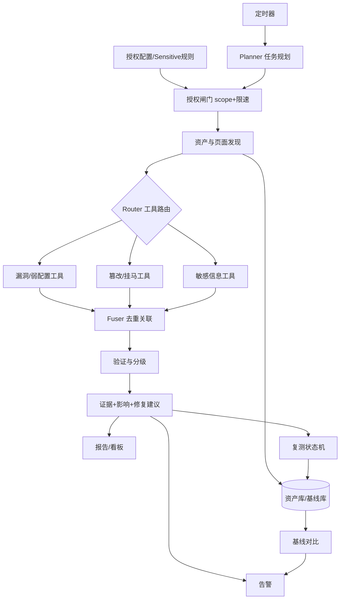

# 02 · 智能体框架设计

> 目标：一个可在恒脑安全智能体平台运行的、**授权范围内**的网站安全巡检智能体。
> 架构图见 `docs/assets/architecture.svg`（板块式总览）。

---

## 一、设计原则

| 原则 | 落地方式 |
| --- | --- |
| 大脑与执行体分离 | 智能体核心只管"规划/推理/解释"；所有检测通过**可插拔工具适配器**调用 |
| 合规前置 | 任何出站请求必须先过**授权闸门 + 限速器**，闸门在编排器外层，工具无法绕过 |
| 被动优先 | 检测能力按"档位"分级（采集/验证/主动），默认停在低档位 |
| 结果归一 | 所有工具输出统一收敛为 **Finding** 数据模型，再进入去重/验证/分级管线 |
| 可解释 | 每条风险必须携带：谁报的、依据什么、证据在哪、为什么是这个等级 |
| 增量巡检 | 先 diff 再深检，控制请求量与耗时，同时提升变更类风险的召回 |
| 记忆复用 | 基线、误报库、指纹库持久化，跨周期生效 |

---

## 二、总体架构：八个板块

```
┌──────────────────────────────────────────────────────────────────────────┐
│ 板块1  接入与授权闸门   控制台/API/定时器 · 授权资产 · scope校验 · 限速 · 审计 │
├──────────────────────────────────────────────────────────────────────────┤
│ 板块2  资产与页面发现   子域枚举 · 存活指纹 · 爬虫/JS解析 · 资源清单 · 快照   │
├──────────────────────────────────────────────────────────────────────────┤
│ 板块3  智能体核心      规划Planner · 路由Router · 编排Executor ·              │
│                        反思Reflector · 去重Fuser · 记忆Memory · 解释Explain   │
├──────────────────────────────────────────────────────────────────────────┤
│ 板块4  检测能力层      漏洞/弱配置 · 篡改/挂马/外链 · 敏感信息（工具适配器池） │
├──────────────────────────────────────────────────────────────────────────┤
│ 板块5  数据与证据层    资产库 · 基线库 · Finding库 · 证据仓 · 规则库 · 误报库 │
├──────────────────────────────────────────────────────────────────────────┤
│ 板块6  闭环运营层      调度 · 基线对比 · 告警 · 复测 · 报告 · 看板 · 工单     │
├──────────────────────────────────────────────────────────────────────────┤
│ 板块7  平台与运行基座  恒脑平台适配 · 容器化部署 · 权限 · 密钥 · 日志审计     │
└──────────────────────────────────────────────────────────────────────────┘
```

### 板块职责

| 板块 | 职责 | 关键产出 |
| --- | --- | --- |
| 1 接入与授权闸门 | 录入授权、范围、周期、敏感信息；执行前校验与限速；审计 | 授权范围对象、限速令牌、审计流水 |
| 2 资产与页面发现 | 找到"有哪些站点、哪些页面、哪些资源" | 资产清单、页面树、资源哈希、页面快照 |
| 3 智能体核心 | 决定"做什么、用什么工具、结果怎么合并、怎么解释" | 任务 DAG、工具调用计划、合并后的风险条目 |
| 4 检测能力层 | 真正干活的开源工具与规则 | 原始检测结果（多工具） |
| 5 数据与证据层 | 统一存储与仲裁 | 结构化 Finding、证据文件、基线快照 |
| 6 闭环运营层 | 定时、对比、告警、复测、报告 | 告警、复测结论、巡检报告 |
| 7 平台与运行基座 | 让整套东西跑得起来、接得上平台 | 部署包、平台智能体、权限模型 |

### 端到端数据流（Mermaid）



---

## 三、多智能体角色设计

采用"**1 个主控 + 4 个执行型子智能体 + 1 个复核智能体**"的编排式多智能体结构，共享黑板（Blackboard）作为协作空间。

| 角色 | 职责 | 输入 | 输出 |
| --- | --- | --- | --- |
| 主控智能体（Orchestrator） | 接收巡检任务、拆解 DAG、分派子任务、汇总与解释、对外对话 | 授权配置、巡检策略 | 任务 DAG、最终报告 |
| 侦察智能体（Recon） | 子域/端口/指纹/爬虫/资源/JS 接口 | 授权范围 | 资产与页面清单 |
| 漏洞智能体（Vuln） | 组件漏洞、弱配置、暴露面 | 资产特征 | 漏洞类 Finding |
| 完整性智能体（Integrity） | 篡改、挂马、恶意外链、视觉比对 | 页面快照 + 基线 | 完整性类 Finding |
| 泄露智能体（Leak） | 关键词/正则/文件/PII/凭据 | 页面与资源内容 + 自定义规则 | 泄露类 Finding |
| 复核智能体（Verifier） | 去重、交叉验证、置信度打分、误报裁决 | 全部 Finding + 证据 | 定级后的风险条目 |

**协作协议要点**

- 子智能体之间不直接调用，只读写黑板，避免环形依赖。
- 每个子智能体只能访问自己"需要知道"的资产切片（最小权限）。
- 主控持有全局预算（请求数/时长/并发），按子任务动态分配，超预算则降级。
- 复核智能体有权**否决**子智能体的结论（例如同一条泄露被白名单命中则降级为"提示"）。

---

## 四、核心机制

### 4.1 任务规划（分层规划）

**第一层：站点级 DAG（确定性，不耗 LLM）**

```
discover → fingerprint → (vuln | integrity | leak) → fuser → verify → grade → report
```

**第二层：资产级动态决策（LLM 参与，给出可读理由）**

规划器读取资产指纹与历史记忆，只在必要时增删子任务，例如：

- 识别为 WordPress → 追加插件枚举与已知插件漏洞模板，跳过通用 CMS 弱口令检测。
- 检测到 SPA（前端路由）→ 追加 JS 接口提取，降低传统爬虫权重。
- 上轮该资产已修复的高危项 → 只跑复测，不跑全量。
- 页面为纯静态展示型且无表单 → 跳过注入类主动检测（省预算、降风险）。

输出结构：`{"subtask": "...", "tool": "...", "reason": "...", "tier": "passive|verify|active", "budget": {...}}`

### 4.2 工具路由矩阵

路由依据四类信号：**资产类型 / 技术栈 / 内容类型 / 历史状态**。

| 资产特征 | 优选工具族 | 安全档位 |
| --- | --- | --- |
| 域名/子域 | 子域枚举 + DNS + 存活探测 | passive |
| 有指纹的 Web 站点 | 模板化 POC 扫描（指纹匹配模板） | passive / verify |
| 动态参数 URL | 参数级漏洞检测（受授权档位约束） | verify（默认）/ active（需显式开启） |
| CMS 站点 | CMS 专项枚举 + 版本比对 | passive |
| HTML 页面 | 正文/DOM/外链提取与规则匹配 | passive |
| JS/CSS 资源 | 密钥特征、接口提取、混淆特征 | passive |
| PDF/Office/压缩包 | 全文与元数据抽取 + 规则匹配 | passive |
| 有基线快照 | 内容 diff + 视觉比对 | passive |
| 同一 finding 复测 | 定向重放该检测项 | verify |

### 4.3 编排与限速降级

- **令牌桶限速**：域名级 + 全局级双层，QPS / 并发数 / 单次总请求数三重上限。
- **超时与重试**：单工具超时 → 重试 1 次 → 仍失败则**降级到替代工具**（如模板扫描失败降级为被动指纹比对）。
- **失败隔离**：单资产失败不阻塞整单；任务级保留"部分成功"状态。
- **幂等**：同一 task_id 重复触发不产生重复数据（去重键 = task + asset + check 指纹）。
- **时间窗**：仅允许在配置的巡检窗口内发请求，窗口外任务排队。

### 4.4 去重与关联算法

三级收敛：

1. **归一化**：统一各工具输出字段（URL 归一化、去除随机参数与时间戳、统一 CVE/CWE 标识）。
2. **指纹合并**：`dedup_key = hash(资产 + 风险类型 + 标准化位置 + 规则/模板ID)`；同 key 合并为一条，保留：最可信工具的证据、最高严重度、所有工具来源列表。
3. **关联聚合**：把"同根因"的多条合并为一条主题风险（例如"备份文件可下载" + "源码泄露" → 一条"敏感文件暴露"），并为每条保留子项，供报告展开。

> 演示技巧：报告里同时给出"原始命中 N 条 → 去重后 M 条 → 确认有效 K 条"，直接把去重能力可视化。

### 4.5 证据与解释

每条风险必须能回答 6 个问题，缺一即为不合格条目：

1. **是什么**（风险名称 + CWE/CVE + 分类）
2. **在哪**（URL / 文件:行 / 元素路径 / 截图区域）
3. **谁发现的**（工具 + 规则 ID + 版本，可追溯）
4. **凭什么**（请求-响应片段、diff、命中上下文，自动脱敏）
5. **有多严重**（分级结果 + 依据：可达性/前置条件/影响面）
6. **怎么办**（修复建议 + 验证方法 + 参考链接）

### 4.6 风险分级模型

```
风险分 = 严重度权重(CVSS或规则基线) × 可达性系数 × 资产重要性系数 × 置信度系数 × 暴露面系数
```

| 因子 | 取值示例 |
| --- | --- |
| 严重度 | 严重 1.0 / 高 0.8 / 中 0.5 / 低 0.2 |
| 可达性 | 互联网可达且无需认证 1.0 / 需认证 0.6 / 仅内网 0.3 |
| 资产重要性 | 门户/办事系统 1.0 / 普通页面 0.5 / 静态资源 0.3 |
| 置信度 | 已二次验证 1.0 / 双工具一致 0.85 / 单工具 0.6 / 仅特征匹配 0.4 |
| 暴露面 | 已确认可访问 1.0 / 疑似 0.7 |

映射到告警等级 **P0（严重）/ P1（高）/ P2（中）/ P3（低/提示）**，P0/P1 触发即时告警，P2 汇总日报，P3 仅入库。

### 4.7 误报治理

- **白名单机制**：域名、路径、参数、规则、敏感词维度均可加白（呼应自定义能力）。
- **交叉验证**：同一结论至少两路证据（如工具命中 + 人工可读的响应特征）。
- **误报反馈闭环**：运营人员标记"误报" → 写入误报库 → 同指纹结果下次自动降级/过滤；这个闭环是"可跟踪"的直接体现。
- **保守策略**：不确定就降级为"疑似/提示"，不占用高危告警通道。

### 4.8 基线与复测状态机

```
新建(New) → 确认(Confirmed) → 修复中(Fixing) → 待复测(RetestPending)
   → 已闭环(Closed)  |  复现(Reopened) → 修复中
   → 误报(FalsePositive)  |  接受风险(Accepted)
```

基线对比四类差异：**新增 / 变更 / 修复 / 复现**。复测使用与首次完全一致的检测项（同规则、同参数），保证可比性。

---

## 五、统一数据模型

| 实体 | 关键字段 |
| --- | --- |
| Authorization | id, 域名/IP段/URL前缀, 授权编号, 有效期, 责任人, 授权书附件, 允许档位 |
| ScopeRule | 包含规则, 排除规则, 端口, 深度, 并发, 时间窗, 限速 |
| SensitiveRule | 类型(keyword/regex/filetype/sample), 表达式/文件类型, 优先级, 白名单, 脱敏策略 |
| Asset | id, 类型(domain/ip/url), 归属, 指纹(框架/CMS/中间件/版本), 存活, 首次发现, 最近发现 |
| Page | url, 所属资产, 标题, 状态码, 内容哈希, DOM 结构哈希, 截图路径, 深度, 父页面 |
| Resource | url, 类型, 大小, 哈希, 引用页面 |
| ScanTask | id, 触发方式, 范围快照, 状态, 开始/结束, 预算, 请求数, 耗时 |
| Finding | id, 资产, 页面, 类型(vuln/misconfig/tamper/malware/leak), 名称, CWE/CVE, 严重度, 置信度, 风险分, 等级, 状态, 首次发现, 最近确认, 去重键, 工具来源[], 证据[], 影响, 修复建议, 复测结论 |
| Evidence | finding_id, 类型(请求响应/diff/截图/命中上下文), 存储路径, 脱敏后摘要 |
| Alert | finding_id, 等级, 渠道, 发送时间, 静默标记, 去重指纹 |
| AuditLog | 时间, 操作主体, 目标资产, 动作, 工具, 请求数, 结果, 拒绝原因 |

---

## 六、一次巡检的端到端时序

1. 调度器触发 task → 加载授权范围与敏感规则快照。
2. 授权闸门校验域名在范围内、授权未过期、处于时间窗 → 发放限速令牌。
3. 侦察智能体执行发现，产出资产/页面/资源，写入资产库并与上轮快照做 diff。
4. 规划器按资产特征生成子任务 DAG（附选择理由），路由器映射到具体工具。
5. 编排器并发执行工具（受限速与预算约束），工具输出归一化为 Finding。
6. 复核智能体去重合并 → 交叉验证 → 置信度打分 → 风险分级。
7. 解释器为每条生成证据摘要、影响说明、分角色修复建议（自动脱敏）。
8. 写入 Finding 库，更新基线快照；与上轮对比得出新增/变更/修复/复现。
9. P0/P1 立即告警（去重聚合 + 静默窗口），其余汇总日报。
10. 运营人员处理后触发复测；复测按原检测项重放，更新状态机并归档报告。

---

## 七、恒脑安全智能体平台适配

> 下列为架构级适配建议；平台具体规范（智能体描述文件、工具协议、调试入口）需以安恒官方文档为准。

| 适配点 | 做法 |
| --- | --- |
| 智能体形态 | 把"主控 + 子智能体"的编排封装为平台可加载的智能体；对外暴露巡检意图（自然语言触发即可发起巡检） |
| 工具接入 | 每个检测工具封装为独立工具（MCP 服务或 HTTP 接口），携带元数据：名称、用途、参数、所需权限、安全档位、依赖 |
| 知识与规则 | 敏感规则库、误报库、指纹库作为平台知识库/配置挂载，支持热更新 |
| 权限 | 平台身份映射到系统角色（管理员/运营/只读），工具按角色授予最小权限 |
| 可观测 | 每次工具调用记录入审计日志，可在平台侧查看推理与调用链 |
| 降级运行 | 平台侧工具不可用时，编排器按路由矩阵降级到备用工具，保证任务可完成 |

---

## 八、部署形态

```
docker-compose
├── web        控制台（授权配置/看板/报告）
├── api        智能体服务（规划/编排/解释）
├── worker    任务执行体（工具适配器池，可横向扩容）
├── scheduler 定时调度
├── postgres  结构化数据（资产/Finding/审计）
├── redis     队列/限速令牌/缓存
├── minio     证据仓（截图/快照/报告文件）
└── tools     工具容器（按需挂载 nuclei/yara/gitleaks 等，离线镜像）
```

要求：**离线可用**（比赛现场网络受限）、一键起停、示例数据与示例授权配置开箱即用。

---

## 九、里程碑建议（4 周）

| 周 | 目标 | 交付 |
| --- | --- | --- |
| 第 1 周 | 打通骨架 | 授权/范围/敏感规则录入、资产发现、单工具跑通、Finding 模型 |
| 第 2 周 | 三类检测上线 | 漏洞/弱配置 + 篡改/挂马 + 敏感信息各 1~2 个工具接入，去重与分级 |
| 第 3 周 | 闭环 | 调度、基线、告警、复测、报告导出、看板 |
| 第 4 周 | 打磨与验证 | 统一测试集自评（召回/准确/误报）、合规演练、恒脑平台适配、文档 |

---

## 十、待确认假设

1. **图片板块**：本次未收到赛题板块图片，上文板块划分基于赛题文本重构；拿到图片后可做一次映射对齐，把板块名称与图片一一对应。
2. **恒脑平台接口**：平台侧智能体封装方式、工具协议、可用工具额度未知，需以官方文档/技术支持为准。
3. **统一测试集**：评委测试集规模与场景未知，检测效果需靠自建靶场（含篡改/挂马/泄露样例）自评。
4. **授权档位**：主动检测（注入/弱口令）默认关闭，是否需要开启取决于现场授权与评审要求。

